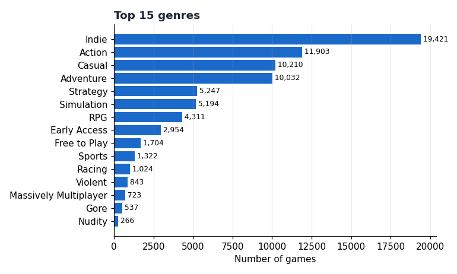
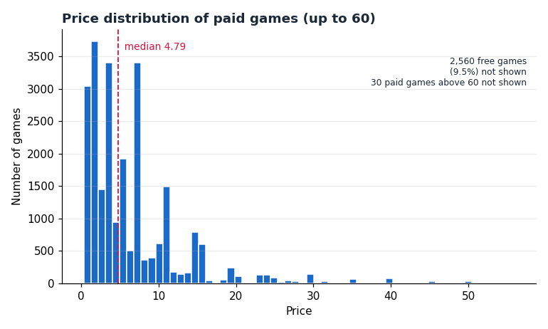
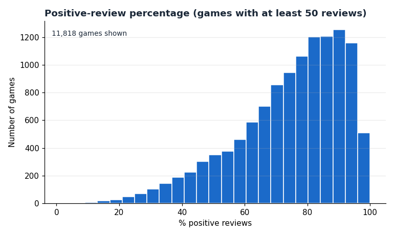
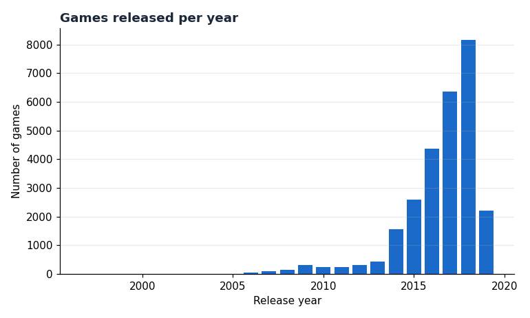

# Steam Game Recommendation System Using Similarity Search

A content-based recommender that analyzes **27,075 Steam games** and, for any game you pick, returns the **top 5 most similar games** with a similarity score. It uses data cleaning, feature engineering, TF-IDF vectorization and **cosine similarity**, wrapped in a Streamlit web app that also includes exploratory data analysis (EDA).

> Every recommendation is **calculated from the dataset at run time**. Nothing is hard-coded.

## Table of contents
1. [Problem statement](#problem-statement)
2. [Objective](#objective)
3. [Features](#features)
4. [Dataset](#dataset)
5. [Technologies used](#technologies-used)
6. [System architecture](#system-architecture)
7. [Data preprocessing](#data-preprocessing)
8. [Feature engineering](#feature-engineering)
9. [Cosine similarity methodology](#cosine-similarity-methodology)
10. [How recommendations are generated](#how-recommendations-are-generated)
11. [Example output](#example-output)
12. [Evaluation](#evaluation)
13. [Data analysis (EDA)](#data-analysis-eda)
14. [Screenshots](#screenshots)
15. [Installation](#installation)
16. [Running locally](#running-locally)
17. [Running the tests](#running-the-tests)
18. [GitHub setup](#github-setup)
19. [Deployment (Streamlit Community Cloud)](#deployment-streamlit-community-cloud)
20. [Project structure](#project-structure)
21. [Limitations](#limitations)
22. [Future enhancements](#future-enhancements)
23. [Viva / interview cheat-sheet](#viva--interview-cheat-sheet)

## Problem statement
Steam hosts tens of thousands of games with different genres, tags, categories, prices and ratings. Users find it hard to discover games similar to ones they already enjoy.

## Objective
Build a recommendation system that analyzes Steam game data and recommends the **top 5 games most similar to a selected game**, using data preprocessing, feature engineering, vectorization and cosine similarity.

## Features
- Search box + dropdown to select any of the 27,075 games (most-reviewed titles listed first)
- Top 5 recommendations with **similarity percentage**, price, review score, review count, estimated owners, genres, tags, developer, platforms and a Steam store link
- "Why it matches": the genres/tags shared with the selected game
- Optional minimum-review filter to hide obscure games
- Clear error message (plus "Did you mean...?" suggestions) when a game does not exist
- Built-in EDA dashboard with 8 charts
- Command-line mode and a 29-test unit-test suite that runs on the real data

## Dataset
`data/steam.csv`: **27,075 games × 18 columns**, release years 1997-2019. It is about 6 MB, so it is committed to the repo and the app runs right after cloning.

**Columns used and why**

| Column | Used for |
|---|---|
| `steamspy_tags` | Similarity (highest weight): the most descriptive gameplay descriptors, e.g. *MOBA, Roguelike, Co-op* |
| `genres` | Similarity: broad genre, e.g. *Action, RPG, Strategy* |
| `categories` | Similarity (lowest text weight): store features, e.g. *Single-player, Steam Cloud* |
| `price` | Similarity (numeric, log-scaled) + display + EDA |
| `positive_ratings`, `negative_ratings` | Similarity (smoothed positive ratio, review count) + display + EDA |
| `release_date` | Converted to release year: similarity + display + EDA |
| `owners` | Range string parsed to numbers: display + EDA |
| `name`, `appid` | Search, labels, Steam store link |
| `developer`, `publisher`, `platforms` | Display (and developer is used in the [evaluation](#evaluation)) |

**Columns loaded but deliberately not used in similarity**

| Column | Reason |
|---|---|
| `english` | 98.1% of games have the same value, so it carries almost no information |
| `required_age` | 97.8% are 0 |
| `average_playtime`, `median_playtime` | 0 for about 77% of games (no data), so mostly noise |
| `achievements` | Very skewed (max 9,821) and weakly related to game type |

The file does not state a currency for `price`, so the app shows plain numbers. Set `CURRENCY_SYMBOL` in `src/config.py` once you have confirmed it.

**Source / licence:** add the link and licence of the page you downloaded the dataset from (see `data/README.md`).

## Technologies used
| Tool | Purpose |
|---|---|
| Python 3.9+ | Language |
| pandas, NumPy | Data cleaning and manipulation |
| scikit-learn | `TfidfVectorizer`, `MinMaxScaler`, `cosine_similarity` |
| SciPy | Sparse matrices (`csr_matrix`, `hstack`) |
| matplotlib | EDA charts |
| Streamlit | Web GUI and free deployment |
| unittest | Tests |
| GitHub Actions | Automatic test runs on every push |

## System architecture

```
 data/steam.csv
       |
       v
 +--------------+   +----------------+   +-------------------+   +------------------+
 | data_loader  |-->| preprocessing  |-->| features          |-->| recommender      |
 | read + check |   | clean + derive |   | TF-IDF + scaling  |   | cosine similarity|
 | columns      |   | columns        |   | -> 27,075 x 401   |   | -> top 5 games   |
 +--------------+   +----------------+   +-------------------+   +--------+---------+
                           |                                              |
                           v                                              v
                      +---------+                                 +--------------+
                      |  eda    |-------------------------------->|  app.py      |
                      | charts  |                                 |  (Streamlit) |
                      +---------+                                 +--------------+
```

## Data preprocessing
Implemented in `src/preprocessing.py`. What the real file needed:

| Issue found in the data | How it is handled |
|---|---|
| 13 names with stray leading/trailing spaces (e.g. `'Exodus from the Earth '`) | Trimmed |
| 1 missing `developer`, 20 missing/blank `publisher` | Filled with `"Unknown"` |
| Duplicate rows / duplicate `appid` | Checked and removed (this file has none, but the code handles them) |
| 62 titles shared by different games (e.g. two unrelated games called *Alone*) | **Kept**: they have different developers. Each gets a unique label: `Name (year)` → `Name (year) - developer` → `... #appid` |
| `owners` stored as a range string like `20000-50000` | Parsed into numeric low/high columns |
| `release_date` as text | Converted to release year (invalid dates would get the median year) |
| Heavily skewed `price` (0 to 421.99; 2,560 free games) and review counts | `log1p` transform before scaling |
| Games with very few reviews make raw positive-% unreliable (2 reviews, both positive = "100%") | Smoothed ratio: `(positive + 10 × global_ratio) / (total + 10)` |
| Missing or invalid numbers in general | Coerced to numeric, repaired (median price, 0 reviews), negatives clipped |

`clean_data()` also returns a report of how many rows each step touched; it is shown in the app's "How it works" tab.

## Feature engineering
Implemented in `src/features.py`. Every game becomes **one vector of 401 numbers**:

```
[ tags (339 TF-IDF) | genres (29 TF-IDF) | categories (29 TF-IDF) | numeric (4) ]
      weight 1.0          weight 0.7           weight 0.4            weight 0.25 each
```

- **Multi-value text → numbers (TF-IDF).** `steamspy_tags`, `genres` and `categories` are `;`-separated lists. Each item (e.g. `Open World`) is one "word". TF-IDF gives **rare** items (e.g. *Roguelike*) more weight than items almost every game has (e.g. *Indie*, in 72% of games), so a shared rare tag says more about similarity.
- **Numeric features:** `log(price)`, smoothed positive-review ratio, `log(review count)` (popularity) and release year. All are MinMax-scaled to 0-1 so no feature dominates because of its units.
- **Weights:** tags are most descriptive (1.0); genres are broader (0.7); categories describe store features rather than gameplay (0.4); numeric features act as gentle nudges and **tie-breakers** (0.25 each). Ties matter: 9,917 games share an *identical* genre + tag + category combination, so text alone could not separate them.
- All weights live in `src/config.py` and are easy to change.

## Cosine similarity methodology
For two game vectors **A** and **B**:

```
                      A · B                 Σ Aᵢ Bᵢ
cos(A, B) = ─────────────────── = ───────────────────────────
                  ‖A‖ × ‖B‖        √(Σ Aᵢ²) × √(Σ Bᵢ²)
```

- It measures the **angle** between the vectors, not their length: 1.0 = same direction (very similar), 0 = nothing in common.
- All values in our vectors are ≥ 0, so scores fall between **0 and 1**, shown as **0-100%**.
- Why cosine and not Euclidean distance? Game vectors are sparse (a game has only a few tags). Cosine ignores how many features a game has and focuses on **which** ones it shares.

## How recommendations are generated
`GameRecommender.recommend()` in `src/recommender.py`:

1. Find the selected game's row (case-insensitive exact title).
2. Compute `cosine_similarity(selected_vector, all_vectors)`, one number per game. Only one row is compared against the matrix, so no 27,075 × 27,075 matrix is needed.
3. Remove the selected game itself and any game below the minimum-review filter.
4. Sort by similarity (ties broken by number of reviews) and keep the top 5.
5. For each result, list the genres/tags it shares with the selected game.

## Example output
Real output of `python -m src.recommender "Portal 2" --min-reviews 10`:

```
1. Trine 3: The Artifacts of Power  -  77.9% similar     shared: Action, Adventure, Co-op, Puzzle
2. Q.U.B.E: Director's Cut          -  76.4% similar     shared: Action, Adventure, First-Person, Puzzle
3. Warhammer: Vermintide 2          -  73.0% similar     shared: Action, Co-op, First-Person
4. The Talos Principle              -  72.0% similar     shared: Action, Adventure, First-Person, Puzzle
5. Shiftlings                       -  69.4% similar     shared: Action, Adventure, Co-op
```

And for `"Dota 2"`: *Games of Glory (89.1%), Iron League (83.1%), Heroes of SoulCraft - Arcade MOBA (81.6%), Strife® (80.5%), Vainglory (80.4%)*, all free-to-play MOBAs.

## Evaluation
The dataset has **no user ratings or purchase history**, so classic recommender accuracy (precision@k against what users played) cannot be measured. As a sanity check, `src/evaluation.py` tests a signal the model was **never given**: the developer.

For 300 random games whose developer has other games in the dataset:

| | Recommended games by the same developer |
|---|---|
| This model (top 5) | **10.00%** |
| 5 random games | 0.07% |

So the model captures real similarity well beyond chance. Run it yourself: `python -m src.evaluation`. This is a sanity check, not a full accuracy benchmark.

## Data analysis (EDA)
The **Data Analysis** tab shows 8 charts: top genres, top tags, price distribution, positive-review percentage, review counts, games released per year, estimated owners, and median price by genre. Sample charts from the real data:

| | |
|---|---|
|  |  |
|  |  |

Headline numbers: 27,075 games, 29 genres, 339 tags, 9.5% free games, median paid price 4.79, 74.5% average positive reviews (games with 50+ reviews).

## Screenshots
Run the app, take these screenshots, save them in `screenshots/` with these names, then replace this section with the image lines below:

| File to create | What to capture |
|---|---|
| `screenshots/recommender.png` | Recommender tab after clicking *Recommend* (search box + top 5 cards) |
| `screenshots/analysis.png` | Data Analysis tab |
| `screenshots/error.png` | Searching a game that does not exist (error message) |

```markdown


```

## Installation
Requires Python 3.9 or newer and Git.

```bash
git clone https://github.com/<your-username>/steam-game-recommender.git
cd steam-game-recommender

# create and activate a virtual environment (recommended)
python -m venv .venv
# Windows:      .venv\Scripts\activate
# macOS/Linux:  source .venv/bin/activate

pip install -r requirements.txt
```

## Running locally
Always run commands from the **project root folder** (the one containing `app.py`).

```bash
streamlit run app.py          # web app, opens at http://localhost:8501
python -m src.recommender "Portal 2"            # command-line demo
python -m src.recommender "Portal 2" --min-reviews 100 --top 10
python -m src.evaluation                         # sanity-check evaluation
```

In VS Code: open the folder (**File > Open Folder**), open a terminal (**Ctrl+`**), activate the virtual environment, then run the commands above.

## Running the tests
```bash
python -m unittest discover -s tests -t . -v
```
29 tests cover data loading errors, cleaning, feature matrix validity, a manual cosine-similarity cross-check, filters, error handling and chart rendering. They run on the real dataset.

## GitHub setup
1. Create an empty repository on GitHub named `steam-game-recommender` (no README/licence/.gitignore: this project already has them).
2. In `LICENSE`, replace `<Your Name>`.
3. In the project folder:

```bash
git init
git add .
git commit -m "Initial commit: Steam game recommender"
git branch -M main
git remote add origin https://github.com/<your-username>/steam-game-recommender.git
git push -u origin main
```
After pushing, check that `data/steam.csv` is on GitHub. The app needs it.

## Deployment (Streamlit Community Cloud)
Streamlit Community Cloud is free and launches apps directly from your GitHub repository.

1. Push the project to GitHub (see above). `app.py` must be in the repo root, and `requirements.txt` and `data/steam.csv` must be committed.
2. Go to <https://share.streamlit.io> and sign in with your GitHub account. Authorize access to the repository if asked.
3. Click **Create app** (older versions of the page say **New app**) and choose to deploy from an existing GitHub repo.
4. Fill in:
   - **Repository:** `<your-username>/steam-game-recommender`
   - **Branch:** `main`
   - **Main file path:** `app.py`
5. Open **Advanced settings** and choose **Python 3.11** or **3.12**. The code works on 3.9+, but Streamlit's default may be older.
6. Click **Deploy**. Streamlit installs everything in `requirements.txt` automatically; the first build takes a few minutes.
7. Your app gets a public URL like `https://<something>.streamlit.app`. Put it at the top of this README.

**Troubleshooting**
- *`ModuleNotFoundError: No module named 'src'`*: you ran the command from the wrong folder; `cd` into the project root.
- *"Dataset not found"*: `data/steam.csv` is missing or was not committed.
- *Build fails on Streamlit Cloud*: open the app's logs, then check that `requirements.txt` is in the repo root.
- After changing code, push to GitHub; the deployed app updates automatically.

## Project structure
```
steam-game-recommender/
├── app.py                    # Streamlit GUI (entry point)
├── requirements.txt
├── README.md
├── LICENSE
├── .gitignore
├── .streamlit/config.toml    # theme
├── .github/workflows/tests.yml
├── data/
│   ├── steam.csv             # the dataset (~6 MB)
│   └── README.md             # dataset instructions
├── src/
│   ├── config.py             # paths, required columns, feature weights
│   ├── data_loader.py        # read CSV + validate columns
│   ├── preprocessing.py      # cleaning + derived columns
│   ├── features.py           # TF-IDF + scaling -> feature matrix
│   ├── recommender.py        # cosine similarity engine (+ CLI)
│   ├── eda.py                # summary stats + charts
│   └── evaluation.py         # same-developer sanity check
├── tests/test_pipeline.py    # 29 unit tests
├── docs/images/              # EDA charts used in this README
└── screenshots/              # app screenshots (add yours)
```

## Limitations
- **Content-based only:** it knows what games *are* (tags, genres, price, rating), not what players with similar taste *do*. There is no user data in this dataset.
- Tags are limited to the top 3 per game in the source data (`steamspy_tags`), so tag information is sparse.
- The data covers releases up to May 2019; newer games are absent.
- Similarity % measures how alike two games' features are. It is not a prediction of whether you will enjoy a game.
- A game and its DLC or sequels often score very high because their metadata is nearly identical.

## Future enhancements
- Add text features: TF-IDF on game descriptions, or sentence embeddings (e.g. Sentence-BERT)
- Hybrid model: combine content similarity with collaborative filtering if user play data (such as the `steam-200k` dataset) is added
- Let users tune the feature weights from the sidebar
- Recommend from several liked games at once (average their vectors)
- Approximate nearest-neighbour search (FAISS / Annoy) for much larger catalogues
- Interactive charts (Plotly) and game cover images from the Steam store
- Offline evaluation with real user play data (precision@k, recall@k)

## Viva / interview cheat-sheet
**What type of recommender is this?** Content-based: it compares item features. It does not use other users' behavior.

**Why TF-IDF?** It converts text-like lists into numbers and down-weights items that almost all games share (like *Indie*), so rare shared tags count more.

**Why cosine similarity?** Vectors are sparse; cosine compares direction (which features are shared) and ignores vector length. Scores stay between 0 and 1.

**Why `log` on price and reviews?** They are extremely skewed (a few games cost 400 or have 2 million reviews). `log` compresses the range so outliers don't dominate.

**Why smooth the rating?** A game with 2 positive reviews is not "100% loved". Blending in the global average with a pseudo-count of 10 pulls low-review games toward the average.

**Why did you not delete duplicate game names?** They are different games (different developers). Deleting them would lose real data, so each gets a unique label.

**How do you know it works with no ground truth?** A manual cosine check in the tests, plus the same-developer sanity check: 10.00% vs 0.07% for random picks.

**What is the time complexity of one recommendation?** One pass over all N games: O(N × F) with sparse vectors, which takes milliseconds for 27,075 games.
